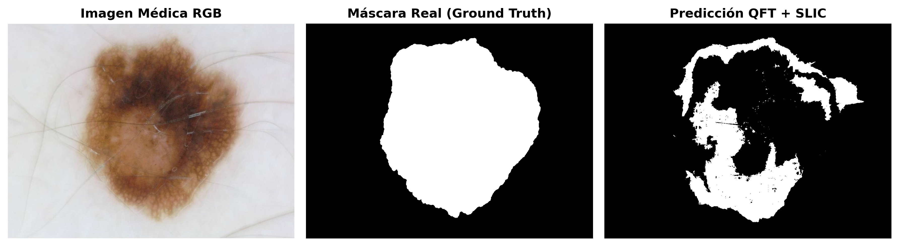

# Summary

**QFT Medical Segmentation** es una herramienta en Python diseñada para la segmentación automática de lesiones cutáneas (melanoma) en imágenes dermatológicas del conjunto de datos ISIC Archive. El sistema integra presegmentación mediante superpíxeles **SLIC**, conversión al espacio algebraico de cuaterniones puros ($q = 0 + Ri + Gj + Bk$), cálculo de la **Transformada Cuaterniónica de Fourier 2D (QFT)** por región, y clasificación supervisada utilizando algoritmos como **Random Forest**, **SVM** y **KNN**.

# Statement of Need

La segmentación precisa de bordes en lesiones dermatológicas es crucial para el diagnóstico temprano del melanoma. Las técnicas convencionales basadas en píxeles canal por canal suelen perder la correlación inter-canal del color RGB. La representación cuaterniónica trata el color como una entidad vectorial holística. Esta canalización proporciona una solución reproducible, ligera y ejecutable en entornos contenedorizados para la investigación clínica.

# Figures and Results

El desempeño del modelo se evalúa sobre el conjunto de test independiente utilizando métricas estandarizadas como el Índice Jaccard (IoU) y el Coeficiente Dice (F1-Score).

{#fig:segmentation width="100%"}

# References