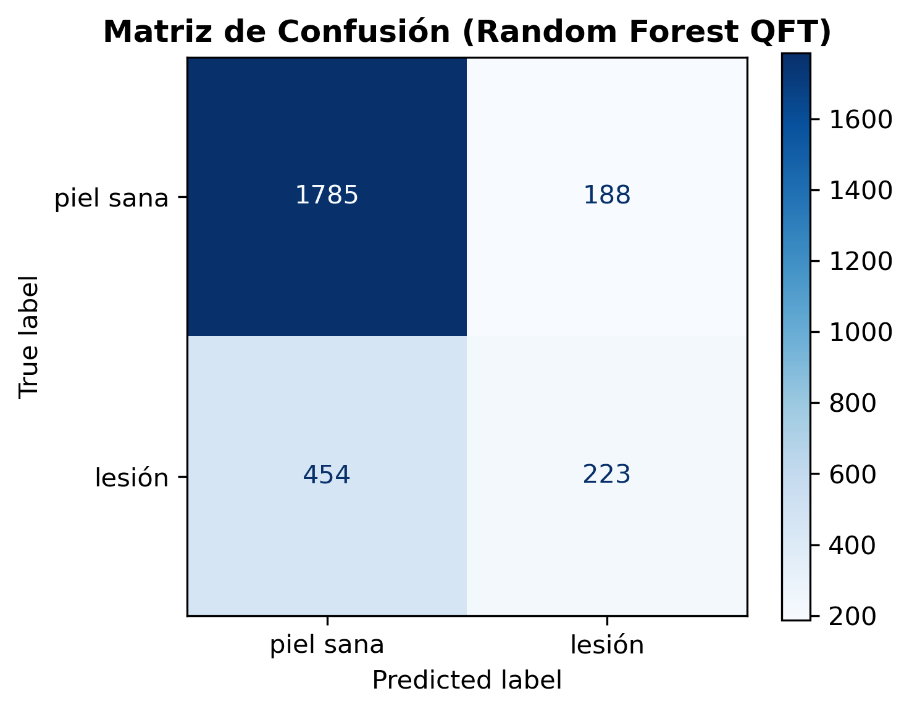
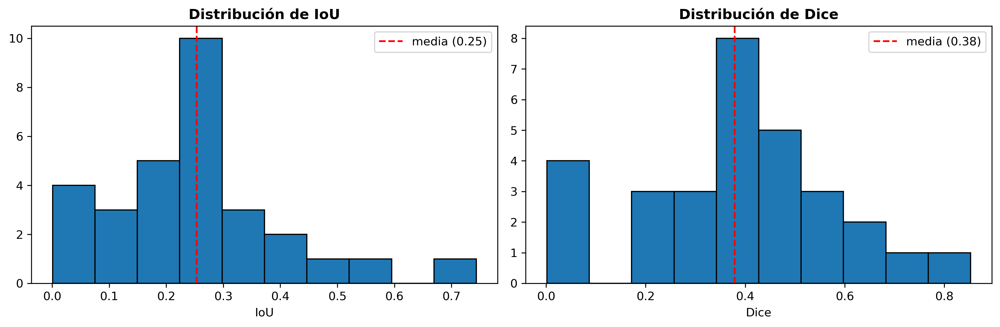

# Summary

El procesamiento digital de imágenes médicas es fundamental en el diagnóstico temprano del melanoma dermatológico [@sangwine1996fourier]. **QFT Medical Segmentation** es una librería y canalización en Python diseñada para segmentar lesiones cutáneas en la base de datos **ISIC Archive 2016** [@gutman2016skin]. El sistema integra el algoritmo **SLIC** (*Simple Linear Iterative Clustering*) para agrupar regiones de interés en $k$ superpíxeles [@achanta2012slic], la **Transformada Cuaterniónica de Fourier 2D (QFT)** para capturar conjuntamente la textura y el espectro cromático RGB en cuaterniones puros, y clasificadores de aprendizaje supervisado (**Random Forest**, **SVM**, **KNN**) [@breiman2001random].

# Statement of Need

Las técnicas tradicionales de segmentación procesan canales de color por separado o convierten las imágenes a escala de grises, perdiendo la correlación entre canales cromáticos. La representación cuaterniónica trata el color RGB como una entidad vectorial holística $q(x,y) = 0 + Ri + Gj + Bk$. Este repositorio proporciona un entorno reproducible, preparado en contenedores **Docker**, con pruebas unitarias en `pytest` e interfaz interactiva en **Streamlit** para la investigación clínica en dermatología computacional.

# Marco Teórico

## Presegmentación en Superpíxeles (SLIC)
El algoritmo SLIC agrupa píxeles en el espacio de 5 dimensiones $\text{CIELAB} + (x,y)$. La distancia compuesta $D_s$ entre dos píxeles $i$ y $j$ se define como:

$$d_{lab} = \sqrt{(L_i - L_j)^2 + (a_i - a_j)^2 + (b_i - b_j)^2}, \quad d_{xy} = \sqrt{(x_i - x_j)^2 + (y_i - y_j)^2}$$

$$D_s = \sqrt{d_{lab}^2 + \left(\frac{m}{S}\right)^2 d_{xy}^2}$$

donde $S = \sqrt{N/k}$ es el intervalo de muestreo y $m$ es la compacidad.

## Transformada Cuaterniónica de Fourier 2D (QFT)
Cada píxel RGB se convierte en un cuaternión puro $q(x,y) = 0 + R\cdot i + G\cdot j + B\cdot k$. La QFT 2D aplicada sobre la caja delimitadora de cada superpíxel transforma el color y la frecuencia espacial de forma unificada:

$$F(u,v) = \frac{1}{\sqrt{M_k N_k}} \sum_{x=0}^{M_k-1} \sum_{y=0}^{N_k-1} e^{-\mu 2\pi \left(\frac{ux}{M_k} + \frac{vy}{N_k}\right)} q(x,y)$$

De cada espectro $F(u,v)$ se extrae un vector de 5 características espectrales: media de magnitud, desviación estándar de magnitud, magnitud máxima, energía espectral y entropía de Shannon.

## Clasificación y Etiquetado Supervisado
Cada superpíxel $S_i$ se etiqueta supervisadamente comparando el traslape con la máscara de referencia (*Ground Truth*):

$$y_i = \begin{cases} 1, & \text{si } \frac{|S_i \cap GT|}{|S_i|} \ge \tau \\ 0, & \text{en otro caso} \end{cases}$$

donde $\tau = 0.9$ (o $\tau = 0.5$) es el umbral de inclusión.

# Arquitectura del Software

El código fuente está estructurado de forma modular dentro de la carpeta `src/`:
- `src/io_utils.py`: Carga y asociación de imágenes RGB y máscaras Ground Truth.
- `src/presegmentation.py`: Agrupamiento en superpíxeles con SLIC ($k=85$).
- `src/quaternion_qft.py`: Conversión cuaterniónica y cálculo de la QFT 2D.
- `src/feature_extraction.py`: Extracción de métricas espectrales y normalización Z-Score.
- `src/classification.py`: Entrenamiento de Random Forest, SVM y KNN.
- `src/evaluation.py`: Reconstrucción espacial de la máscara binaria e inferencia de métricas clínicas (IoU, Dice, Precisión, Recall).

# Resultados y Discusión

## Comparación de Clasificadores
En la validación cruzada sobre el conjunto de superpíxeles, el modelo **Random Forest** obtuvo el mejor desempeño global:

| Modelo | Accuracy | Precisión (Lesión) | Recall (Lesión) | F1-Score (Lesión) |
| :--- | :---: | :---: | :---: | :---: |
| **SVM (RBF)** | 0.86 | 0.87 | 0.44 | 0.58 |
| **KNN ($k=5$)** | 0.82 | 0.59 | 0.56 | 0.58 |
| **Random Forest** | **0.87** | **0.81** | **0.54** | **0.65** |
| **Random Forest (Balanced)** | 0.86 | 0.77 | 0.53 | 0.63 |

{#fig:confusion_matrices width="100%"}

## Evaluación Cuantitativa en Test (379 imágenes)
Evaluado sobre el conjunto oficial de prueba de **ISIC 2016** ($N=379$), el sistema obtuvo los siguientes resultados:

| Métrica | Media | Desv. Estándar | Mínimo | Máximo |
| :--- | :---: | :---: | :---: | :---: |
| **IoU (Jaccard)** | **0.5497** | 0.2106 | 0.1043 | 0.9181 |
| **Dice (F1-Score)** | **0.6850** | 0.1956 | 0.1888 | 0.9573 |
| **Precisión** | **0.7703** | 0.2466 | 0.1355 | 0.9995 |
| **Recall (Sensibilidad)** | **0.6467** | 0.1956 | 0.3113 | 0.9628 |

{#fig:histograms width="100%"}

## Análisis Cualitativo
El modelo destaca en lesiones con alto contraste cromático y decae en bordes difusos o lesiones claras sobre piel clara:

{#fig:cases width="100%"}

# Conclusiones y Trabajo Futuro

La combinación de superpíxeles SLIC y QFT 2D permite capturar simultáneamente color y textura. Para resolver los casos con bajo contraste (tonos rosa/café), se propone integrar una etapa de ecualización de contraste adaptativa (CLAHE) previo a la presegmentación.

# References